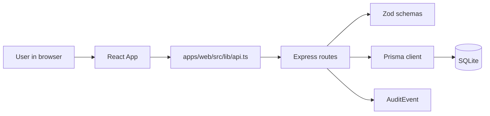

# 01 System Map

## Repo Shape

BuildJira is a TypeScript npm workspace monorepo. The root declares `packages/*` and `apps/*` workspaces (`package.json:7-10`) and composes dev/build/test/lint/db commands (`package.json:11-19`).

```text
buildjira/
  apps/
    api/      Express + Prisma + Vitest
    web/      React + Vite
  packages/
    shared/   Zod schemas and exported TypeScript types
  docs/
    upskill/  this curriculum
```

## Runtime Surfaces

| Surface | Owner | Entry | Public interface | Private internals |
| --- | --- | --- | --- | --- |
| Browser UI | `apps/web` | `apps/web/src/main.tsx:1-16` | Fetch calls in `apps/web/src/lib/api.ts:31-44` | Component state in `apps/web/src/App.tsx:21-335` |
| API server | `apps/api` | `apps/api/src/server.ts:1-7` | `/health`, `/api/projects`, `/api/projects/:key/board`, `/api/issues/:id` | Route mappers in `apps/api/src/routes/projects.ts:24-237` |
| Shared contract | `packages/shared` | `packages/shared/src/index.ts:1-101` | Exported schemas and inferred types | None; contract-only package |
| Persistence | `apps/api/prisma` | `apps/api/prisma/schema.prisma:1-93` | Prisma models | SQLite bootstrap SQL in `apps/api/prisma/bootstrap.ts:5-97` |
| Tests | `apps/api/test` | `apps/api/test/projects.test.ts:1-34` | Vitest/Supertest checks | Seeded DB dependency in `apps/api/test/projects.test.ts:8-12` |
| Deployment | root Docker | `docker-compose.yml:1-27` | API `4000`, web `8080` | Dockerfiles under `apps/api` and `apps/web` |

## Ownership Boundaries

- UI owns local interaction state, selection, display, and form events (`apps/web/src/App.tsx:21-99`, `apps/web/src/App.tsx:159-335`).
- API owns transport middleware, parsing, security headers, CORS, logging, routing, and error translation (`apps/api/src/app.ts:14-45`).
- Shared owns the stable JSON contract and must not import API/web code (`packages/shared/src/index.ts:3-101`).
- Persistence owns relational shape, foreign keys, and seed data (`apps/api/prisma/schema.prisma:10-93`, `apps/api/prisma/seed.ts:13-191`).

## Public Interfaces

| Interface | Evidence | Notes |
| --- | --- | --- |
| JSON schemas | `packages/shared/src/index.ts:17-88` | Client and server both rely on these shapes. |
| API routes | `apps/api/src/routes/projects.ts:54-237` | Main resource routes. |
| Health endpoint | `apps/api/src/routes/health.ts:6-13` | Operations/readiness signal. |
| Environment variables | `.env.example:1-4`, `apps/api/src/config/env.ts:4-13` | API validates server env; web uses Vite env. |
| Docker ports | `docker-compose.yml:10-22` | API `4000`, web `8080`. |



## Drill

Pick one file from each runtime surface and write inputs, outputs, dependency imports, and one boundary it should not cross.

Self-grade:

- Basic: names five files.
- Solid: explains UI/API/shared/data ownership.
- Strong: identifies one boundary leak or missing boundary and proposes a low-risk improvement.
